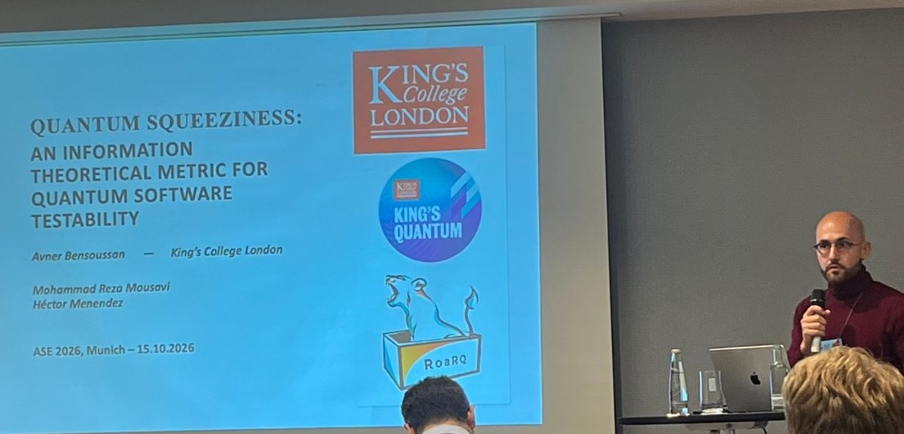
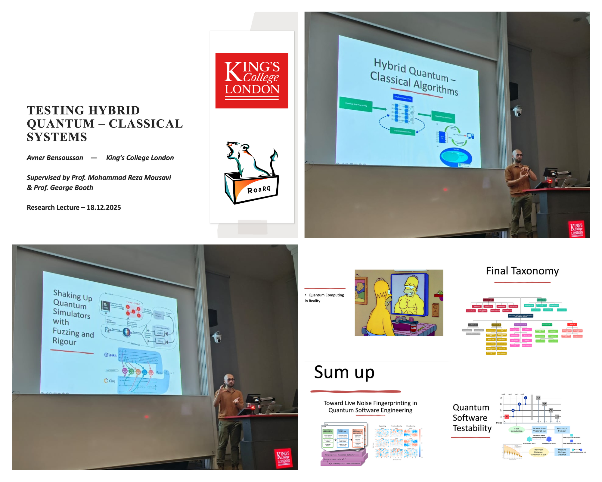
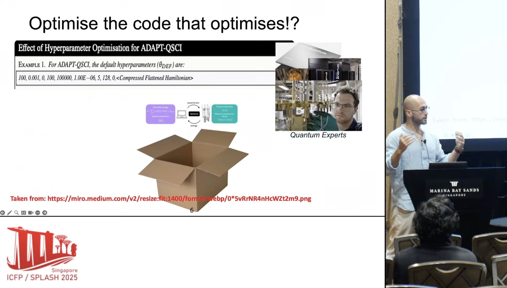
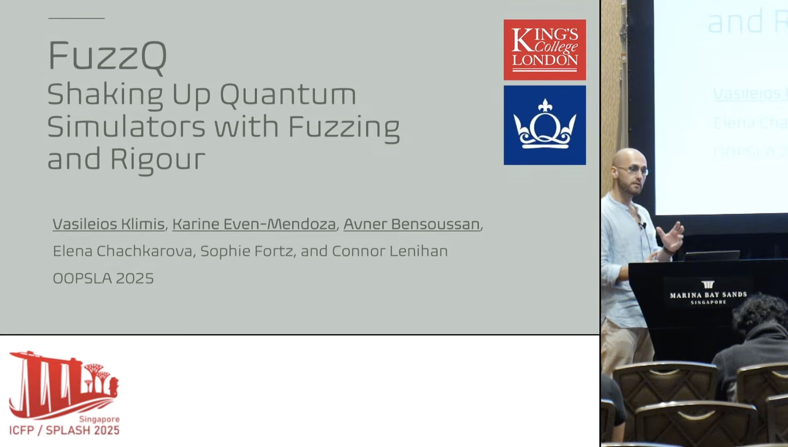
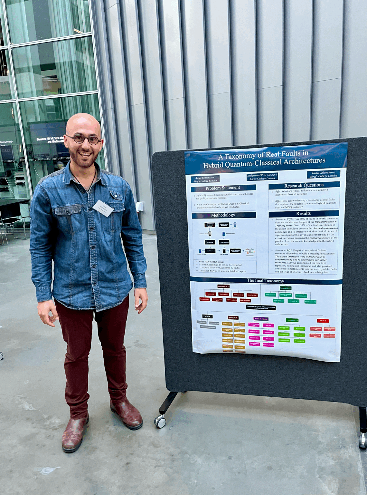

Below are selected presentations and invited talks given in academic and research venues.

---

🇩🇪 Conference Presentation — ASE 2026, Munich

I presented our paper, Quantum Squeeziness: Information-Theoretic Foundations of Quantum Software Testability, which introduces a **theoretical foundation for assessing the testability of quantum software**, at ASE 2026 in Munich, Germany.

Presented paper:

<a href="https://dl.acm.org/doi/10.1145/3832783.3834341" target="_blank">Quantum Squeeziness: Information-Theoretic Foundations of Quantum Software Testability</a>

  
   
  <em>Presenting at ASE 2026 — Munich, Germany</em>

---

## 🎓 Guest Lecture — King’s College London

I had the honour to be invited as a **guest lecturer at King’s College London**, where I presented my PhD research to **3rd-year Bachelor and Master students** in the context of **Prof. Mohammad Reza Mousavi’s Testing Module**.

  
   
  <em>Guest lecture at King’s College London — Testing Module</em>

---

## 🌏 Conference Presentation — OOPSLA 2025, Singapore

I presented **two collaborative research papers at OOPSLA 2025 in Singapore**, focusing on testing, verification and optimisation techniques for quantum and hybrid systems.

**Presented papers:**

- <a href="https://dl.acm.org/doi/abs/10.1145/3763132" target="_blank">Accelerating Quantum Eigensolver Algorithms with Machine Learning</a>
- <a href="https://dl.acm.org/doi/abs/10.1145/3763100" target="_blank">Shaking Up Quantum Simulators with Fuzzing and Rigour</a>

  

    
    <em>Presenting at OOPSLA 2025 — Singapore</em>
  

  

    
    <em>Collaborative work on quantum software testing</em>
  

---

## 🏫 Summer School Presentation — ITU Copenhagen

I presented my work on **faults in Hybrid Quantum-Classical architectures** at the **PICS Summer School** hosted by the **IT University of Copenhagen**.  
The presentation was based on our taxonomy of real faults observed in Hybrid Quantum-Classical architectures.

**Project repository:**  
<a href="https://github.com/avnerbensoussan/A-Taxonomy-of-Real-Faults-in-Hybrid-Quantum-Classical-Architectures" target="_blank">
A Taxonomy of Real Faults in Hybrid Quantum-Classical Architectures
</a>

  
   
  <em>Summer School presentation — IT University of Copenhagen</em>

